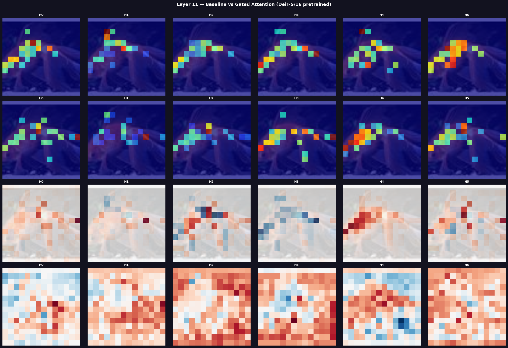

# Attention Sink Study in Vision Transformers

### Vision Transformer의 Attention Sink 탐구와 Gated Attention 실험

**Attention sink의 개념을 공부하고, Vision Transformer의 attention 분포와 gate 적용에 따른 변화를 직접 관찰한 독립심화학습 프로젝트입니다.**

이미지 분류 정확도와 함께 모델이 어떤 토큰에 attention을 분배하는지 살펴보았습니다. DINOv3를 활용한 초기 실험을 거쳐, 현재는 **DeiT-S/16 기본 모델과 gate 적용 모델을 Tiny ImageNet에서 학습하고 비교**하는 과정으로 정리했습니다.

📄 [연구 보고서 — Attention Sink와 DeiT](AttentionSink_DeiT_최종본.pdf) · 🧪 [대표 실험 노트북](run.ipynb)

## 탐구 동기와 질문

Attention map에서 값이 크게 나타나는 영역을 보며, 높은 attention이 항상 중요한 정보를 의미하는지 궁금했습니다. Attention sink라는 개념을 바탕으로 다음 질문을 탐구했습니다.

1. Vision Transformer의 attention은 레이어와 헤드에 따라 어떻게 분포하는가?
2. CLS 토큰에 모이는 attention과 CLS가 이미지 패치에 보내는 attention은 어떻게 다른가?
3. Attention 출력에 학습 가능한 gate를 추가하면 분류 정확도와 attention 분포가 어떻게 달라지는가?

## 공부한 내용

### Attention sink

Attention sink는 토큰의 의미적 중요성과 별개로 특정 토큰에 큰 attention이 모이는 현상을 설명하는 개념입니다. 언어 모델의 초기 토큰에서 관찰된 사례는 [Efficient Streaming Language Models with Attention Sinks](https://arxiv.org/abs/2309.17453)에서 확인할 수 있습니다.

이 프로젝트에서는 이 개념을 출발점으로 ViT의 attention 집중 양상을 조사했습니다. **특정 패치의 attention이 높거나 CLS에 attention이 모인다는 사실만으로 sink라고 단정하지 않고**, attention의 방향·분포와 분류 결과를 함께 살펴보았습니다.

### Vision Transformer와 CLS 토큰

이미지를 패치 단위의 토큰으로 표현하고, self-attention으로 토큰 간 정보를 교환하는 구조를 공부했습니다. 분류에는 backbone 출력의 CLS 토큰을 사용하고, 그 뒤에 `hidden_size → 512 → 200` 크기의 분류기를 연결했습니다.

분석에서는 두 방향을 구분했습니다.

- **CLS → Patch:** CLS가 이미지의 어느 패치에 attention을 보내는지 관찰합니다.
- **Patch → CLS:** 패치 토큰들이 CLS에 보내는 attention을 살펴봅니다.

### Attention output gating

Attention 입력 hidden state에서 sigmoid gate를 계산하고, attention의 출력 projection 직전에 적용했습니다.

```text
Attention 입력 X ── Linear → Sigmoid ── Gate G
                                           │
Attention 출력 Y = concat(AV) ────────────── × → 기존 output projection
```

현재 구현은 토큰·헤드·차원별 gate를 사용합니다. `keep_cls_ungated=True`로 CLS 출력의 gate는 1로 유지하고, `target_layers`로 gate를 넣을 레이어를 선택합니다. 대표 실험에서는 전체 12개 레이어에 적용했습니다.

## 실험 과정

| 단계 | 진행 내용 | 관련 파일 |
| --- | --- | --- |
| 초기 탐색 | DINOv3 기반 분류, 전체 미세조정, gate와 분류기만 학습하는 설정 실험 | `excute/` |
| 기준 모델 학습 | 사전학습된 DeiT-S/16에 200개 클래스 분류기를 연결하고 전체 미세조정 | `run.ipynb` |
| Gate 모델 학습 | 같은 backbone에 gate를 추가하고 backbone·gate·분류기를 함께 학습 | `run.ipynb`, `src/re_make_Gate.py` |
| Attention 관찰 | Q/K로 attention을 계산하고 레이어·헤드별 map과 gate heatmap 생성 | `src/gated_attention/` |
| 비교와 해석 | 분류 정확도, attention 집중 지표, gate와 attention의 상관관계 비교 | `src/gated_attention/analyze.py` |

### 대표 실험 설정

아래 설정은 현재 [run.ipynb](run.ipynb)의 DeiT 비교 실험을 기준으로 합니다.

| 항목 | 설정 |
| --- | --- |
| Backbone | `facebook/deit-small-patch16-224` |
| 데이터셋 | `zh-plus/tiny-imagenet`, 200개 클래스 |
| 학습 / 검증 | `train` / `valid` split |
| 전처리 | RGB 변환 → 224×224 resize → tensor 변환 |
| 학습 방식 | 전체 파라미터 미세조정 |
| Optimizer / 학습률 | Adam / `1e-4` |
| Batch size | 128 |
| 최대 epoch / early stopping | 100 / 검증 정확도 개선 없이 3회 진행 시 종료 |
| 기본 분류 손실 | Cross-entropy |
| Gated 설정 | 전체 레이어에 gate 적용, CLS gate 고정, `gate_lambda=0.01` |
| 실험 기록 | MLflow에 손실·정확도·gate loss와 모델 가중치 저장 |

Gate 학습에는 `compute_gate_loss()`가 계산하는 gate 평균값과 음의 엔트로피 항의 가중합을 분류 손실에 더합니다. 정확한 수식은 [src/re_make_Gate.py](src/re_make_Gate.py)에 있습니다.

## 실험 결과와 관찰

### 분류 정확도

`run.ipynb`에 저장된 학습 로그에서 확인한 최고 검증 정확도입니다.

| 모델 | 최고 검증 정확도 | 학습 기록 |
| --- | ---: | --- |
| DeiT-S/16 Baseline | **82.10%** | Epoch 0–5, early stopping |
| DeiT-S/16 + Gate | **80.71%** | Epoch 0–5, early stopping |

이 실험에서 gate 적용 모델은 기본 모델보다 **1.39%p 낮은 검증 정확도**를 보였습니다. Gate를 추가하는 것만으로 분류 성능이 개선되지는 않았으며, attention 분포 변화와 분류 정확도를 별도로 확인할 필요가 있었습니다.

이 수치는 저장된 한 번의 실험 기록이며, 여러 seed의 평균이나 독립적인 최종 테스트 결과가 아닙니다. 노트북의 `Test Accuracy` 로그는 실제로 `valid` split에 대한 평가입니다.

### Attention 비교 예시

로컬에 저장된 **마지막 레이어(index 11)의 비교 그림**입니다. 각 열은 H0–H5의 6개 헤드를 나타냅니다.



위에서부터 **기본 모델의 CLS→Patch attention**, **gate 모델의 CLS→Patch attention**, **두 값의 차이(Gated−Baseline)**, **gate heatmap**입니다. 출처는 `outputs/deit_compare/comparison/layer_11_comparison.png`이며, 문서에서 볼 수 있도록 복사했습니다.

그림에서는 모델과 헤드에 따라 높은 attention이 나타나는 위치가 달라지는 모습을 관찰할 수 있습니다. Attention 그림은 상위 값을 강조하고 개별 map을 정규화하므로, 색의 강도만으로 두 모델의 절대 attention 크기를 비교하지 않습니다. 한 이미지의 시각화는 전체 데이터에서 sink가 감소했다는 결론과도 구분합니다.

### Attention 집중도 분석

시각화와 함께 다음 지표를 계산하는 코드를 작성했습니다.

| 지표 | 코드에서 계산하는 값 |
| --- | --- |
| Sink score | CLS→Patch attention의 최댓값 / 평균값 |
| Top-1 ratio | CLS→Patch attention의 최댓값 / 합계 |
| CLS received ratio | Patch→CLS attention의 합 / 전체 attention 행렬의 합 |
| Gate–attention 상관관계 | 헤드별 gate 평균값과 CLS→Patch attention의 Pearson·Spearman 상관계수 |

그 밖에 엔트로피, 분산, Gini, effective rank 및 Wilcoxon 검정 코드도 포함합니다. 지표의 계산 정의와 표본 단위를 확인하는 과정까지 탐구 범위로 두었으며, 이 README에서는 해당 지표로 sink 억제 효과가 입증되었다고 결론 내리지 않습니다.

## 탐구를 통해 정리한 점

- **Attention을 읽을 때 방향과 단위를 구분해야 합니다.** CLS→Patch와 Patch→CLS는 서로 다른 질문에 답하며, 레이어·헤드별로 따로 살펴볼 필요가 있습니다.
- **구조의 변화와 성능의 향상은 별도로 확인해야 합니다.** Gate 적용 모델에서도 학습과 attention 변화가 관찰되지만, 이번 분류 결과는 기본 모델보다 낮았습니다.
- **시각화는 수치와 함께 해석해야 합니다.** 정규화 방식과 강조할 attention 비율에 따라 그림의 인상이 달라질 수 있습니다.
- **가설을 비교 가능한 실험으로 옮기는 과정이 중요합니다.** 기본 모델을 기준으로 두고, 동일 데이터에서 gate 모델을 학습·기록·분석하는 절차를 구성했습니다.

후속 과제로는 gate 적용 레이어와 정규화 강도별 비교, 여러 이미지·seed에서의 반복 평가, 집중도 지표의 수식 및 정규화 검증을 두고 있습니다.

## 프로젝트 구성

```text
deep-learning-study/
├── README.md
├── AttentionSink_DeiT_최종본.pdf  # 연구 보고서
├── run.ipynb                    # 현재 DeiT baseline / gated 학습·분석
├── excute/                      # 초기 DINOv3 실험 노트북
├── requirements.txt
├── docs/images/                 # README에 사용한 실제 실험 그림
└── src/
    ├── data.py                  # 이미지 전처리와 Dataset
    ├── model.py                 # Backbone + CLS 분류기
    ├── training.py              # 학습, early stopping, MLflow 기록
    ├── evaluating.py            # 분류 손실과 정확도 평가
    ├── re_make_Gate.py          # Gate 주입과 gate loss
    ├── gated_attention/         # Gate 수집, 시각화, 기본 모델과 비교
    ├── not_gated_attention/     # 기본 모델 분석 코드
    ├── figures.py               # 학습 기록 시각화 보조 함수
    └── config.py                # 초기 실험 설정
```

## 실행 안내

현재 로컬 환경에서 확인한 버전은 Python **3.12.3**, PyTorch **2.10.0**, torchvision **0.25.0**, Transformers **5.3.0**, datasets **4.7.0**, MLflow **3.10.1**입니다. 저장된 대표 학습 로그의 GPU는 NVIDIA GeForce RTX 5060 Ti입니다.

기존 WSL 환경에서는 다음과 같이 노트북을 엽니다.

```bash
cd /home/hyuksu/deep-learning-study
source venv/bin/activate
python -m jupyterlab run.ipynb
```

1. 기본 모델과 gate 모델의 학습 셀을 각각 실행합니다. 이미 가중치가 있다면 해당 모델 로드 셀부터 실행할 수 있습니다.
2. `baseline_model`과 `gated_model`을 로드한 뒤 `run_comparison()` 셀로 비교합니다. DeiT 설정은 `img_size=224`, `patch_size=16`입니다.
3. 결과 그림은 `outputs/deit_compare/comparison/`, 학습 가중치는 `outputs/`에서 확인합니다.

MLflow 기록은 프로젝트 루트에서 다음 명령으로 확인할 수 있습니다.

```bash
mlflow ui --backend-store-uri sqlite:///mlruns.db
```

새 환경에서는 하드웨어에 맞는 PyTorch 설치가 필요합니다. `requirements.txt`에 `transformers`가 빠져 있으므로 별도 설치가 필요하며, 노트북의 절대 저장 경로도 자신의 환경에 맞춰 변경해야 합니다. 데이터·가중치·MLflow 기록은 Git 추적 대상에서 제외되어 있습니다.

### 재실행 시 확인할 부분

- `run.ipynb`의 기본 모델 단독 시각화 셀에는 이전 모듈명 `src.attention_deep`을 참조하는 import 오류가 남아 있습니다. 비교 분석은 `src.gated_attention.run_analysis.run_comparison`을 진입점으로 사용합니다.
- `excute/`에는 과거 gate 함수 인자와 모듈명을 사용하는 노트북이 있습니다. 현재 실험 순서와 모델 설정은 `run.ipynb`를 기준으로 확인합니다. `config.py`의 초기 DINOv3 설정이 이 노트북에 자동 적용되지는 않습니다.
- 단일 모델 분석의 `Gate×QK`는 후처리 지표입니다. 실제 gate는 attention 출력에 적용되므로, 그 곱셈 결과를 별도 학습한 기본 모델과의 비교로 해석하지 않습니다.
- 집중도 통계에는 첫 번째 샘플과 레이어·헤드 단위 값이 사용됩니다. 여러 이미지·반복 실험으로의 일반화와 엔트로피 정규화·Gini 부호 등 계산 정의의 검증은 후속 과제입니다.

이 프로젝트의 중심은 attention sink에 관한 질문을 직접 구현·실험·시각화하며 이해해 본 학습 과정입니다.
